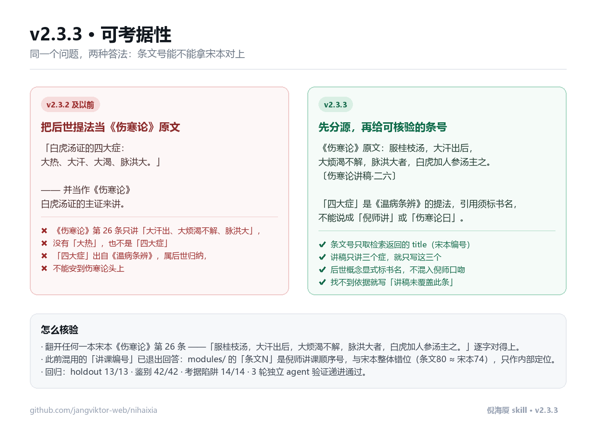

<div align="center">


# 倪海厦skill · 经方中医AI

**将经方大师倪海厦的完整中医思维体系注入 AI Agent**

`129条伤寒论+太阳下篇阳明篇补齐` · `23篇金匮` · `72篇黄帝内经` · `374种本草` · `1,257例结构化医案+243例叙事` · `2,452页讲义` · `3.5M字精萃`

[](https://github.com/jangviktor-web/nihaixia/stargazers)
[](https://github.com/jangviktor-web/nihaixia/releases)
[](LICENSE)
[]()
[](#安装)

**🌐 [中文](https://github.com/jangviktor-web/nihaixia/blob/main/README.md) | [English](https://github.com/jangviktor-web/nihaixia/blob/main/README_EN.MD) | [日本語](https://github.com/jangviktor-web/nihaixia/blob/main/README_JA.md) | [한국어](https://github.com/jangviktor-web/nihaixia/blob/main/README_KO.md)**

</div>

---

> 「中医很简单，就是阴阳气血。你搞懂了，一通百通。」—— 倪海厦

### 一句话介绍

将倪海厦（1954-2012）的中医思维、人纪系列教学、临床心法、天纪命理蒸馏为可激活的 Agent Skill，使 AI 能以倪海厦的视角进行六经辨证、经方选药、解读症状。

**直接激活词**：`倪海厦` / `海厦视角` / `倪师` / `经方思维` / `倪海厦会怎么看`

---

## 快速安装

<details open>
<summary><b> ClawHub（推荐）</b></summary>

```bash
openclaw skills install @jangviktor-web/nihaixia
```
</details>

<details>
<summary><b>SkillHub（腾讯云）</b></summary>

```bash
curl -fsSL https://skillhub.cn/install/install.sh | bash -s -- --no-skills
skillhub install nihaixia-pro
```
</details>

<details>
<summary><b>OpenClaw / 手动安装</b></summary>

```bash
# OpenClaw
openclaw skills install @jangviktor-web/nihaixia


# 手动安装（复制到任意 runtime 的 skills 目录）
git clone https://github.com/jangviktor-web/nihaixia.git
# 示例：OpenClaw → ~/.openclaw/skills/ ；Claude Code → ~/.claude/skills/ ；Codex → ~/.codex/skills/
cp -r nihaixia/ ~/.openclaw/skills/nihaixia/
```
</details>

<details>
<summary><b>手机端（腾讯 IMA APP）</b></summary>

下载腾讯 IMA APP，扫描下面知识码，无需配置直接使用。


倪海厦skill腾讯ima地址： https://ima.qq.com/skill?shareId=70e35c8a24ed4c01a0986f9e3c83f3d1&from=share

调用方法：


</details>


---

## 功能矩阵

| 能力 | 覆盖范围 | 说明 |
|:---|:---:|:---|
| 六经辨证 | ✅ | 太阳/阳明/少阳/太阴/少阴/厥阴，传变规律+欲解时 |
| **六经辨证诊断公式** | ✅ | **8个诊断公式+快速诊断流程图+脉舌速查+七步走思维模式（v2.1.0新增）** |
| 经方选药 | ✅ | 伤寒论129条+太阳下篇阳明篇补齐+金匮23篇，含组成/剂量/煎服法/禁忌 |
| 药物性味 | ✅ | 神农本草经374种，三品分类+五味归经+炮制要点 |
| 临床医案 | ✅ | 1,257例结构化医案+243例分类叙事医案，按癌症/心血管/代谢病等7类分类 |
| 针灸穴位 | ✅ | 十二经络+井荣俞经合+任督要穴+中风急救 |
| 黄帝内经 | ✅ | 72篇完整蒸馏，中医基础理论核心 |
| 天纪命理 | ✅ | 紫微斗数+易经六十四卦+阳宅风水 |
| 梁冬对话 | ✅ | 2009年7期完整录音蒸馏，现代话题观点 |
|第三届扶阳论坛演讲|✅|扶阳理论/阴虚→阳虚→阴实传变链/红斑狼疮血癌脑瘤临床重案/生附子生硫黄分类应用|
|仲景心法讲授讲|✅|经方剂量学/桂枝汤群方之祖/风湿甘附汤→知母汤→乌头汤递进/消化系统经方对应/奶水即月经·七癌同源/掌背额温差秒断阴阳手诊法|
|斯坦福大学演讲 + 弟子经验|✅|从感冒一路治到癌症/经方入门三步走/李宗恩杨贞弟子实录/望诊总结+诊病十问/常用压痛点/胆肾结石专方|
| 闭门课 | ✅ | 7大重病专题+7堂弟子课，血癌/乳癌/脑瘤等 |
| 口述表达 | ✅ | 倪海厦口语风格模块，回复"像"倪师 |
| **可考据性** | ✅ | **条文号统一宋本编号（可拿任何一本宋本逐条核验）+ 出处纪律（禁止把后世概念归给《伤寒论》）+ 出处审计（自动挑出无据方名）+ 考据陷阱判据 14/14（v2.3.3 新增）** |
| **检索器可复现** | ✅ | `scripts/nishi_retrieve.py` 纯 stdlib，确定性检索；`--selftest` 自检 + 三套回归（holdout 13/13、鉴别 42/42、考据 14/14） |

---

## 使用示例

**感冒辨证**
> **Q**：我感冒了，怕冷，没有汗，脖子后面疼
> **A**：太阳伤寒，麻黄汤证。无汗恶寒、体痛——寒束于表。麻黄开毛孔，桂枝解肌，杏仁降气。

**方剂查询**
> **Q**：小柴胡汤什么时候用？
> **A**：少阳病主方。口苦、咽干、目眩、往来寒热——但见一证便是。

**药物性味**
> **Q**：生附子和炮附子区别？
> **A**：生附子——阴寒在里，四逆证。炮附子——表阳不固，汗出恶风。

**医案参考**
> **Q**：有没有肝癌的医案？
> **A**：有，147个癌症医案。肝癌案例常用攻坚处方配合疏肝理气。

---

## 核心知识体系

### 六经辨证速查

```
太阳（表）→ 阳明（里热）→ 少阳（半表半里）
         ↓ 失治误治
太阴（脾寒）→ 少阴（心肾阳虚）→ 厥阴（阴阳逆乱 / 上热下寒）
```

### 倪氏六健康标准

1. 一觉到天亮，无失眠
2. 胃口正常，三餐有饱饿感
3. 每天晨起大便
4. 一天小便 5-7 次，淡清黄色
5. 头面冷、手足温热（四季皆然）
6. 晨起阳反应

---

## 效果演示

### v2.3.3 · 可考据性

<div align="center">

**同一个问题，两种答法：条文号能不能拿宋本对上**


</div>

### 经典辨证

<div align="center">

**六经辨证基础应用**


**六经传变规律**


**日常养生与饮食禁忌**


</div>

---

## 相关项目

<div align="center">

### [汉唐中医 · 安卓诊断 APP](https://github.com/jangviktor-web/nihaixia-app)

同一个知识库，独立的安卓应用。离线可用，完全免费。

[](https://github.com/jangviktor-web/nihaixia-app/releases/latest)
[](https://github.com/jangviktor-web/nihaixia-app)

| 六经辨证诊断 | 271首方剂速查 | 345味药物速查 | 子午流注取穴 |
|:---:|:---:|:---:|:---:|
| 智能问诊引导 | 搜索+六经筛选 | 性味归经分类 | 361穴时间推算 |

</div>

<div align="center">
         
### [李可skill · 急危重症中医AI](https://github.com/jangviktor-web/likeskill)

李可老中医（1930-2013）急危重症思维操作系统。395个医案、170+首方剂、92种症状路由、25种假证识别。

与倪海厦skill互补：倪海厦覆盖全科教学（849医案），李可专注急危重症实战（附子最大750g）。

[](https://github.com/jangviktor-web/likeskill)
[](https://clawhub.ai/jangviktor-web/skills/like)

| 破格救心汤 | 假证识别25种 | 圆运动理论 | 经方剂量体系 |
|:---:|:---:|:---:|:---:|
| 附子30-750g | 假阳证24+假阴证1 | 彭子益完整蒸馏 | 汉代一两=15.625g |

</div>

<div align="center">

### [胡希恕skill · 经方中医AI](https://github.com/jangviktor-web/huxishu)

将胡希恕（1898-1984）的经方临床思维、六经八纲辨证体系、方证对应心法蒸馏为可激活的 Agent Skill，使 AI 能以胡希恕的视角进行六经辨证、方证鉴别、临床选方。

胡希恕被誉为"经方传道第一人"，其"六经来自八纲"的创见是对《伤寒论》辨证体系最清晰的解读，直接影响了冯世纶等当代经方名家。

与倪海厦skill互补：倪海厦覆盖全科教学（849医案），胡希恕是经方传道第一人，是对《伤寒论》辨证体系最清晰的解读。

[](https://github.com/jangviktor-web/huxishu)
[](https://clawhub.ai/jangviktor-web/skills/huxishu)

</div>

<div align="center">

### [温病派吴鞠通skill · 温病派中医AI](https://github.com/jangviktor-web/wujutong)
**吴鞠通**（1758-1836）——温病学派集大成者，三焦辨证 + 卫气营血，359 医案 45 病证，自称"羽翼伤寒"，以"津液的存亡"为核心，温病禁汗、甘寒存津，护阴第一。

| 维度 | 倪海厦（经方） | 吴鞠通（温病派） |
|------|--------------|--------------|
| **辨证** | 六经（看深浅） | 三焦（看部位） |
| **治法核心** | 驱邪外出 | 存津液 |
| **汗法** | 该汗则汗 | 温病禁汗 |
| **方剂** | 药少力专（麻黄/附子/乌头） | 药多面广（银翘/白虎/复脉） |
| **医案** | 849 案全科 | 359 案温病+杂病 |

**互补关系**：倪海厦修水龙头（温阳化湿治本），吴鞠通扫积水（清湿护津治标）——一纵一横，急性期从吴、缓解期从倪，合观乃得中医外感病全貌。

[](https://github.com/jangviktor-web/wujutong)
[](https://clawhub.ai/jangviktor-web/skills/wujutong)

</div>


## 数据来源

<details>
<summary><b>点击查看完整数据来源清单（10份讲义，2,452页）</b></summary>

| 讲义 | 页数 | 提取字符 | 状态 |
|---|---|---|---|
| 伤寒论讲义 | 209 页 | 277K | 全量蒸馏 |
| 金匮要略讲义 | 419 页 | 626K | 全量蒸馏 |
| 黄帝内经讲义 | 461 页 | 227K | 全量蒸馏 |
| 针灸教程讲义 | 216 页 | 347K | 全量蒸馏 |
| 神农本草经文稿 | 339 页 | 843K | 全量蒸馏 |
| 天机道（紫微斗数） | 75 页 | 85K | 全量蒸馏 |
| 人间道（易经） | 146 页 | 164K | 全量蒸馏 |
| 地脉道（风水） | 65 页 | 52K | 全量蒸馏 |
| 汉唐文章集锦 | 383 页 | 670K | 10 篇蒸馏 |
| 倪海厦文集 | 139 页 | 234K | 8 则医案蒸馏 |
| **合计** | **2,452 页** | **3.5M** | |

</details>

<details>
<summary><b>点击查看仓库目录结构</b></summary>

```
nihaixia/
├── SKILL.md                    # 主技能文件（107KB/1,548行，含开阖枢图/原穴全表等六大速查块+角色规则+剂量体系）
├── expression_style.md         # 倪海厦口语表达 DNA（嚎用法/反问互动/断言收束）
├── distilled_cases.md          # 243 例分类叙事医案合并版
├── index.html                  # 详情页
├── logo.jpg                    # 项目 Logo
├── modules/                    # 14 个知识模块
│   ├── 01_shanghan_sun.md      # 伤寒论太阳病篇（条文1-129 逐条解读）
│   ├── 02_shanghan_other.md    # 伤寒论阳明/少阳/太阴/少阴/厥阴
│   ├── 03_yian.md              # 医案集（849 例）
│   ├── 04_jingui.md            # 金匮要略 23 篇完整解读
│   ├── 05_huangdi_neijing.md   # 黄帝内经 72 篇 + 上古天真论
│   ├── 06_liangdong.md         # 梁冬对话全文
│   ├── 07_bimen_hantang.md     # 闭门课 + 汉唐文章
│   ├── 08_huangdi_detail.md    # 黄帝内经讲义详细篇目（461 页）
│   ├── 09_zhenjiu_bencao.md    # 针灸教程 + 神农本草经 374 种 + 天纪 + 六十四卦全表
│   ├── 10_fuyang_luntan.md     # 第三届扶阳论坛演讲（经方阴阳+癌症重案）
│   ├── 11_zhongjing_xinfa.md   # 仲景心法（剂量学+手诊+七癌同源）
│   ├── 12_stanford_jingfang.md # 斯坦福演讲+经方妙用+弟子经验
│   ├── 13_shanghan_quebing.md  # 伤寒论条文补齐（太阳下篇+阳明篇）
│   └── 14_yijinjing_bidu.md    # 易筋经 + 五脏逼毒法
├── cases/                      # 医案库（1,500+ 条）
│   ├── 00_merged_table.md      # 1,257 例全量结构化医案表（12列：诊断/病机/方剂/针灸/疗程/观点）
│   ├── 01_cancer.md            # 147 个癌症医案
│   ├── 02_cardiovascular.md    # 22 个心血管医案
│   ├── 03_metabolic.md         # 12 个代谢病医案
│   ├── 04_autoimmune.md        # 2 个自身免疫医案
│   ├── 05_neurological.md      # 3 个神经精神医案
│   └── 06_other.md             # 59 个其他医案
├── references/
│   ├── distilled/              # 蒸馏速查层（6 文件）
│   │   ├── 01-six-meridian-formulas.md # 六经辨证诊断公式（966 行）
│   │   ├── 02-acupuncture-quick-ref.md # 针灸公式速查（621 行）
│   │   ├── 03-clinical-experience.md   # 感冒六大经方 + 病机十九条（150 行）
│   │   ├── 04-acupuncture-highlights.md # 针灸重点内容汇编（1,761 行）
│   │   ├── README.md                   # 蒸馏目录说明
│   │   └── audit-notes.md              # 教验报告
│   ├── research/               # 研究资料（10 文件：著作/对话/表达DNA/外部评价/决策/时间线/教学法/临床案例/综合/蒸馏日志）
│   ├── audit/                  # 方剂与针灸审计清单（fangji_112.txt / zhenjiu_164.txt）
│   └── CHANGELOG.md            # 变更记录
```
</details>

---

## 更新日志

<details>
<summary><b>点击展开完整更新日志</b></summary>

#### v2.3.3 (2026-11-27) — 出处纪律与可考据性：条文号可核验

核心升级：把「回答能不能被用户逐条核验」变成硬约束。新增出处纪律、溯源标记、问答纪律；检索器补否定词/方位词豁免；加出处审计函数与考据陷阱判据。

- **出处纪律**：条文号只取检索返回的 `title`（宋本编号）；讲稿只讲「大汗出、大烦渴、脉洪大」就只写这三个，不得拿《温病条辨》「四大症」给《伤寒论》背书；方剂库摘要非倪师原话
- **溯源标记**：行内写 `〔伤寒论讲稿·九六〕`、`〔金匮要略讲稿·呕而发热〕`、`医案 #序号`，可逐条回查
- **编号统一**：索引 `title` 前缀＝宋本编号，面向用户一律用它；`modules/` 的「条文N」是讲稿顺序号（与宋本错位），只作内部定位，不得写进回答
- **检索器**：否定词（不渴／无汗／不恶寒）与方位词（左边／肚子／早上）进 priority 档豁免自由率——holdout 12/13 → **13/13**
- **出处审计**：`unverified_formulas()` 挑出回答中无检索依据的方名，只标注不拦截
- **考据陷阱判据**：`test_source_discipline.py` 按句判后世概念是否被归给《伤寒论》，含否定式与反问豁免，14/14 通过
- **剂量核对**：检索片段按 520 字截断，方剂剂量必须回 `modules/` 搜方名取原方行逐字核对
- **验证**：`--selftest` 通过、holdout 13/13、differential 42/42、考据 14/14；3 轮独立 agent 验证递进通过（v1 抓到剂量误判 → v2 抓到编号混入 → v3 全通过）

---

#### v2.3.0 (2026-08-14) — 达尔文安全机制重构：固定免责框 + 给方优先级铁律

核心升级：修复 SKILL.md 安全条款自相矛盾（8处冲突），确立「正文零安全话术 + 文末固定免责框一次」机制，恢复倪师风格"给完整方剂"的默认行为。

新增内容：

#### 安全机制重构（达尔文.skill 2.0 流程）
- **固定免责框机制**：每题文末输出一次固定文案免责框（"本内容仅用于中医学习与学术研究，不构成医疗诊断、处方或个体化治疗建议"），正文零"请找中医师/建议就医"式话术
- **免责框三版**：常规版（默认）/ 重症版（已确诊癌症/中风/心梗等）/ 急救版（急性发作），按主诉自动选择，每题且仅一次
- **给方优先级裁决（铁律）**：常规辨证问诊必须给完整方剂（组成+剂量+煎服法+禁忌），禁止因安全顾虑只给方向不给方
- **条款冲突修复**：统一 493⑤/519/522（安全提示位置）、1400（开场话术）、1408/1506/1508/1514（"不给处方"条款）为单一机制——"不给处方"仅约束怂恿自行抓药，不约束学术展示
- **胸痹重症模板加固**：急性发作送医提示由急救版免责框承载，教学三层出方照常完整输出（部分命中仍三层全给）

#### 质量验证
- 达尔文 9 维评分：72.7/100 → 重构后独立 judge 三场景（常规/重症/急救）审计通过
- 独立验证：正文必给完整方、正文零安全话术、免责框文末一次
- 旧话术 grep 全文零残留

---

#### v2.2.0 (2026-08-12) — 知识库蒸馏速查 + 倪师演讲三讲 + 易经六十四卦全量升级

核心升级：新增结构化速查层与三场倪师重要演讲，SKILL.md 入口植入开阖枢图/原穴全表/五输穴公式等六大速查块，六十四卦从简洁列表升级为完整人事应用百科。

新增内容：

#### 蒸馏速查层（references/distilled/，6 文件，232KB）
- 六经辨证诊断公式：8 公式 + 快速诊断流程图 + 脉舌速查 + 合病并病速查 + 真寒假热鉴别 + 七步走辨证思维模式（966 行）
- 针灸公式速查本：子午流注口诀 + 十二经原穴全表 + 五输穴属性规律 + 子母补泻公式（621 行）
- 感冒六大经方手册：桂枝汤/麻黄汤/葛根汤/大青龙汤/小青龙汤/小柴胡汤 主症+剂量+禁忌（150 行）
- 针灸重点内容汇编：任督二脉要穴 + 十二经络穴位 + 针灸治症精选（1,761 行）
- 教验报告：深度蒸馏知识库 42 篇 vs 现有 skill 四维度抽样对比结论

#### 三场倪师重要演讲（modules/10-12，28KB）
- 第三届扶阳论坛演讲（2009.10）：扶阳理论/阴虚→阳虚→阴实传变链/红斑狼疮血癌脑瘤临床重案/生附子生硫黄分类应用（182 行）
- 仲景心法讲授（2009.12）：经方剂量学/桂枝汤群方之祖/风湿甘附汤→知母汤→乌头汤递进/消化系统经方对应/奶水即月经·七癌同源/掌背额温差秒断阴阳手诊法（218 行）
- 斯坦福大学演讲 + 弟子经验（2010.09）：从感冒一路治到癌症/经方入门三步走/李宗恩杨贞弟子实录/望诊总结+诊病十问/常用压痛点/胆肾结石专方（185 行）

#### SKILL.md 入口速查升级（+130 行）
- 开阖枢总图：三阳（太阳开→少阳枢→阳明阖）+ 三阴（太阴开→少阴枢→厥阴阖）ASCII 可视化图
- 伤寒论两大补虚方铁律：小建中汤（表阳虚，太阳兼太阴）+ 炙甘草汤（里阴虚，少阴阴阳两虚）
- 十二经原穴全表：12 经 × 时辰 × 五行 × 原穴 +「肺寅大卯胃辰宫」口诀
- 感冒六大经方速查：主症关键 + 剂量核心一图呈现
- 素材路径索引：9 文件行数/适用场景速查表

#### modules/09 六十四卦全量升级
- 原版简洁列表→完整结构化表格：64 卦 × 4 列（序号·卦名·卦象符号·人事应用）
- 新增地天泰卦专章：卦德解释 + 6 条核心人事解读（泰否一念间/包荒治泰/师道之泰/诸葛亮三顾茅庐/婆媳之道/鉴定器量四句话）+ 阳宅应用（妻居西北角）+ 占卜图示 + 倪师金句
- 新增易经总论：易经非算命书，乃君子避小人之人间道指南

#### 教验增强
- 与深度蒸馏知识库覆盖四维度逐维度抽样对比（伤寒/金匮/内经/针灸/诊断公式/临床经验）
- 结论：现有 skill 覆盖 95% 事实，无重大冲突，补充开阖枢可视化图/两大补虚方汇总/七步思维模式/真寒假热鉴别
- 关键词索引新增 3 板块：扶阳论坛/癌症临床、仲景心法、斯坦福演讲

| 指标 | v2.1.0 | v2.2.0 |
|------|:-----:|:-----:|
| 总文件数 | 31 | 42 |
| 知识模块 | 9 | 12 |
| SKILL.md 行数 | 11,169 | 11,277 |
| 六十四卦展示 | 简列表 | 64 卦全表 + 卦象符号 |
| 诊断公式 | 零散于正文 | 独立速查文件 966 行 |
| 演讲模块 | 0 | 3（扶阳+仲景+斯坦福） |
---
#### v2.1.0 (2026-06-08) — 六经辨证诊断公式

**核心升级**：从知识库查询工具升级为具备六经辨证思维模式的临床诊断助手。

**新增内容**：
- **8个诊断公式**：太阳/阳明/少阳/太阴/少阴/厥阴/少阴热化/合病并病，每个含IF-THEN辨证规则+分型鉴别表+代表方剂
- **快速诊断流程图**：从患者症状到六经定位的完整决策树
- **脉诊速查**：8种单脉+8种复合脉象
- **舌诊速查**：5种舌象+6种复合舌象+脉舌矛盾决策树
- **真寒假热/假寒鉴别**：八维法（面色/口鼻气/舌形/脉象/胸腹/小便/口渴/大便）+危重证候警示
- **合病/并病速查**：11种组合+治疗先后原则
- **七步走辨证思维模式**：定表里→分阴阳→辨寒热→判传变→审体质→选方剂→精细加减
- **用药铁律**：7条禁忌+5条急救方案
- **建中汤系列**：小建中/黄芪建中/当归建中/大建中（太阴病扩展）
- **治肝三法**：乌梅丸/吴茱萸汤/小建中汤（金匮核心）
- **八味肾气丸详解**：三补三泻+桂附八味丸vs六味地黄丸
- **金匮杂病六经归属速查**：12种杂病+代表方剂
- **金匮特有方剂六经归属**：咳喘类4方+补虚类8方+历节类3方（含完整组成）
- **11处交叉引用**：诊断公式→modules/详细条文的双向链接

**数据来源**：
- 倪海厦《伤寒论讲义》（人纪系列）
- 倪海厦《黄帝内经讲义》（人纪系列）
- 倪海厦《金匮要略讲义》（人纪系列）

**质量验证**：
- 达尔文skill评分：9.4/10
- 10个临床场景测试：10/10覆盖
- 11个方剂剂量逐方核对：100%与源文件一致
- 六经提纲条文核对：6条中5条完全一致，1条异体字差异

**SKILL.md变化**：+476行（10,697→11,169行），新增第6097-6545行

---

- **v2.0.1** (2026-05-26)：新增分类医案库 cases/（245 例）+ 研究资料 references/；修复 .gitignore
- **v2.0.0** (2026-05-25)：仓库精简——移除原始参考资料(110MB)，仅保留运行必需文件(4MB)
- **v1.1.2** (2026-05-24)：详情页重写——新增安装教程、使用示例
- **v1.1.1** (2026-05-24)：更名为「倪海厦skill」，slug 改为 `nihaixia`
- **v1.1.0** (2026-05-23)：神农本草经药性体系深度蒸馏；关键词索引全面优化
- **v1.0.1** (2026-05-02)：结构优化；OCR 校正 13 处；新增汉唐文章精华 10 篇
- **v1.0.0** (2026-04-14)：初版发布

</details>

---

## 致谢

- 感谢 [huoyalong](https://github.com/huoyalong/nihaisha-skill) 提供 nihaisha-skill 基础框架
- 感谢 [9527qingfeng](https://github.com/9527qingfeng/hantang-nihaixia-follower) 提供医案数据支持

---

## Star History

[](https://repostars.dev/?repos=jangviktor-web%2Fnihaixia&theme=grape)

---


## 免责声明

本项目内容仅供中医学习与研究，不替代专业医疗诊断。所有诊疗请务必咨询执业医师。Skill 内置固定免责框，AI 回答仅用于学习与研究，不构成医疗建议。

---

<div align="center">

**基于 [nihaisha-skill](https://github.com/huoyalong/nihaisha-skill) 二次开发 · 遵循 MulanPSL-2.0 开源协议**

[](https://clawhub.ai/jangviktor-web/skills/nihaixia)
[](https://openclawmp.cc)
[](https://skillhub.cloud.tencent.com/skills/nihaixia-pro)

</div>
