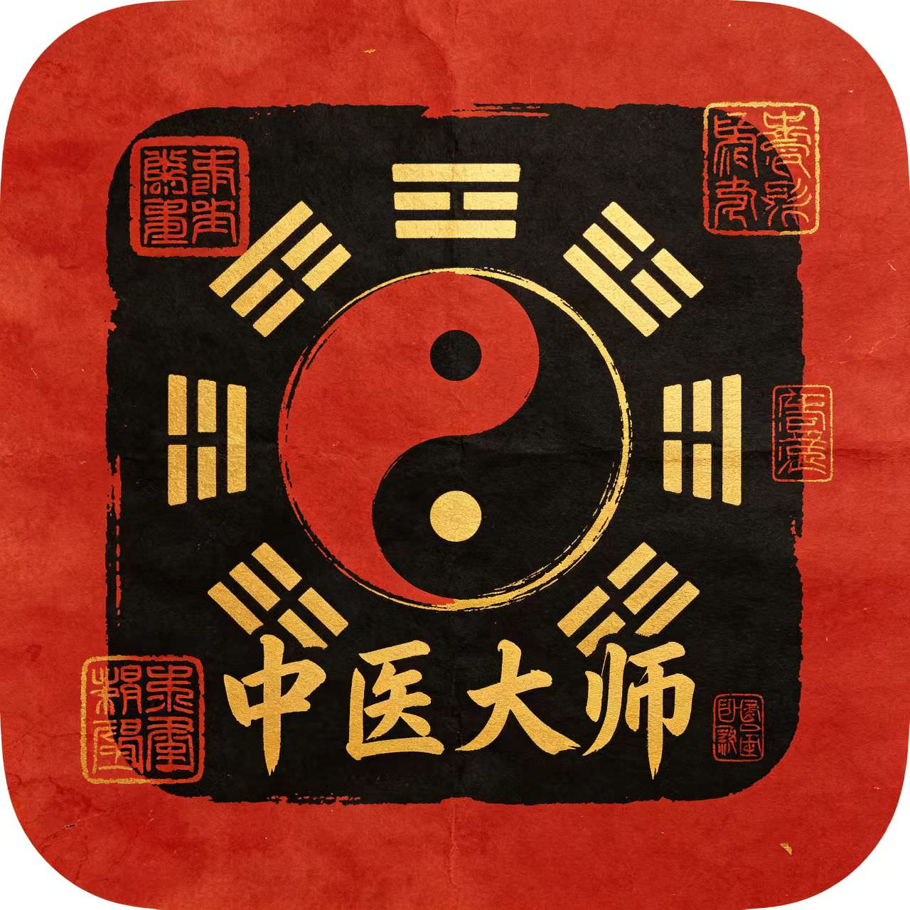
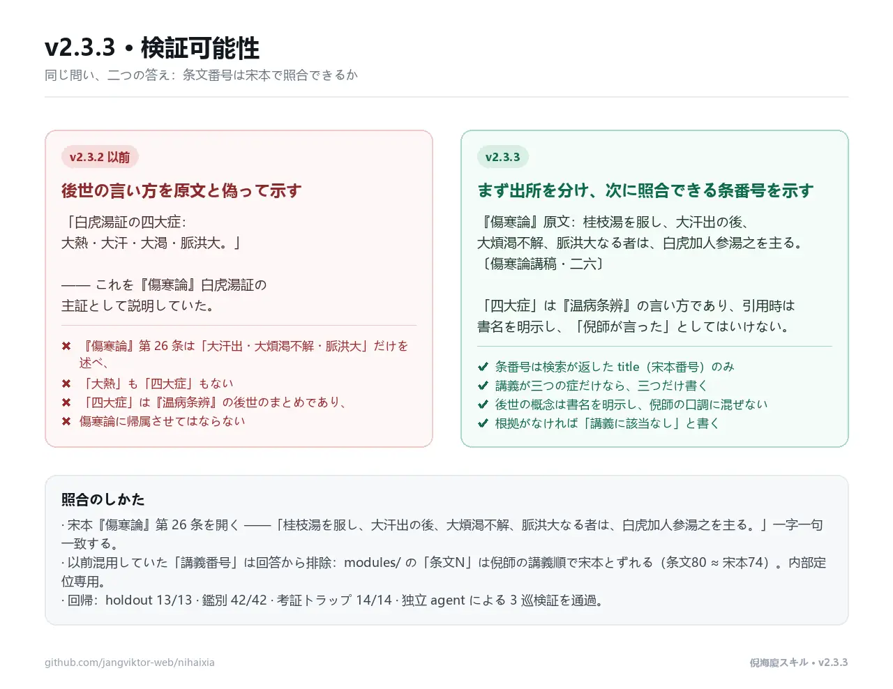
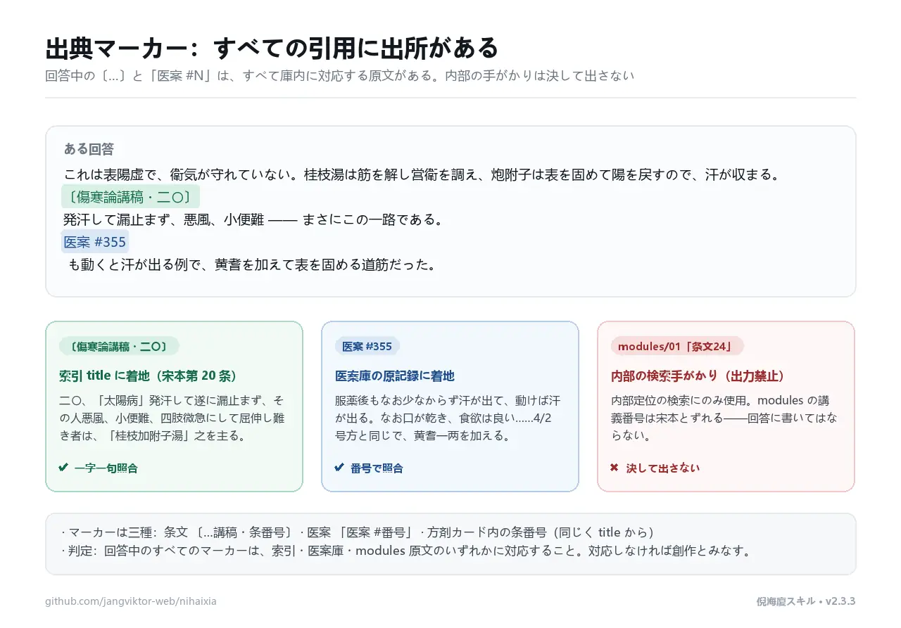
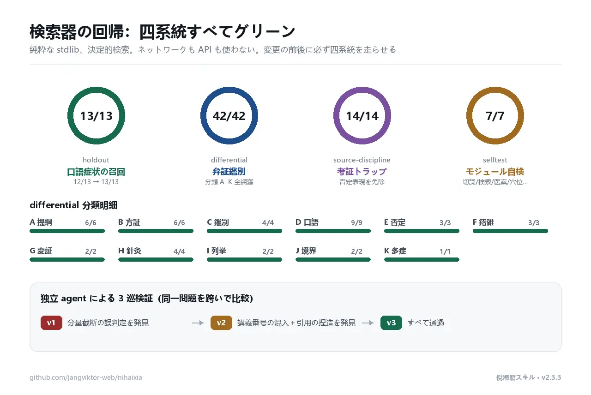
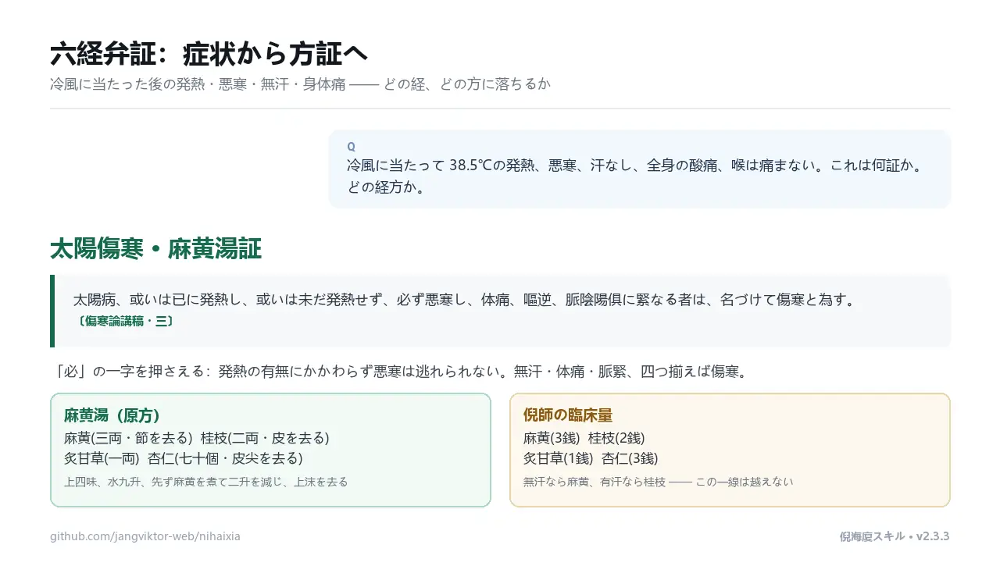
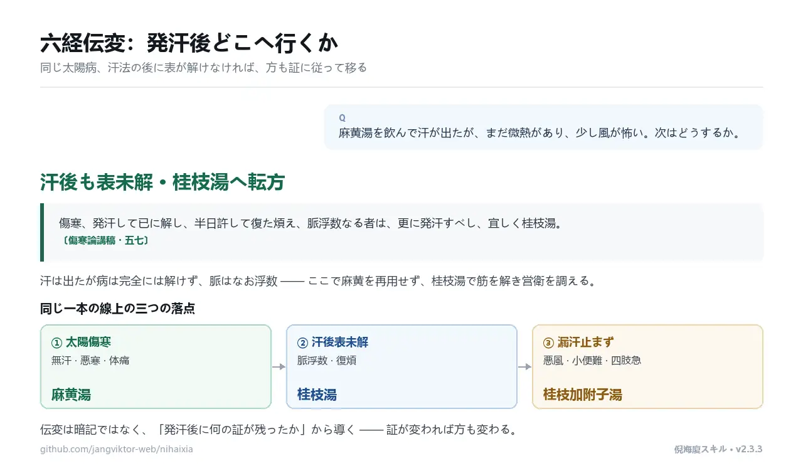
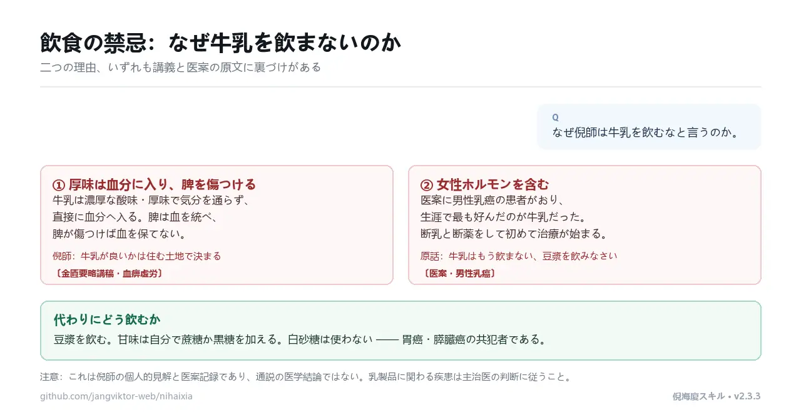

<div align="center">



# 倪海廈スキル · 経方中医学AI

**経方の大家・倪海廈の中医思考体系を AI エージェントに注入する**

`傷寒論129条＋太陽下篇・陽明篇補完` · `金匱要略23篇` · `黄帝内経72篇` · `本草374種` · `構造化医案1,257例＋叙述医案243例` · `講義2,452ページ` · `精粋350万字`

[](https://github.com/jangviktor-web/nihaixia/stargazers)
[](https://github.com/jangviktor-web/nihaixia/releases)
[](LICENSE)
[]()
[](#クイックインストール)

**🌐 [中文](https://github.com/jangviktor-web/nihaixia/blob/main/README.md) | [English](https://github.com/jangviktor-web/nihaixia/blob/main/README_EN.MD) | [日本語](https://github.com/jangviktor-web/nihaixia/blob/main/README_JA.md) | [한국어](https://github.com/jangviktor-web/nihaixia/blob/main/README_KO.md)**

</div>

---

> 「中医学は簡単だ。陰陽と気血、それだけだ。それが分かれば、すべて通じる。」——倪海廈

### ひとことで言うと

倪海廈（1954-2012）の中医思考、人紀シリーズの講義、臨床の心法、天紀の命理を、起動可能な Agent Skill として蒸留したもの。AI が倪海廈の視点で六経弁証・経方選薬・症状解釈を行えるようになる。

**起動キーワード**：`倪海廈` / `海廈視点` / `倪師` / `経方思考` / `倪海廈ならどう見るか`

---

## クイックインストール

<details open>
<summary><b>ClawHub（推奨）</b></summary>

```bash
openclaw skills install @jangviktor-web/nihaixia
```
</details>

<details>
<summary><b>SkillHub（Tencent Cloud）</b></summary>

```bash
curl -fsSL https://skillhub.cn/install/install.sh | bash -s -- --no-skills
skillhub install nihaixia-pro
```
</details>

<details>
<summary><b>手動インストール（任意のランタイムの skills ディレクトリへコピー）</b></summary>

```bash
git clone https://github.com/jangviktor-web/nihaixia.git

# 例：OpenClaw → ~/.openclaw/skills/
#     Claude Code → ~/.claude/skills/
#     Codex → ~/.codex/skills/
cp -r nihaixia ~/.openclaw/skills/
```
</details>

---

## 機能マトリクス

| 能力 | 対応 | 内容 |
|:---|:---:|:---|
| 六経弁証 | ✅ | 太陽／陽明／少陽／太陰／少陰／厥陰、伝変の法則＋欲解時 |
| **六経弁証の診断公式** | ✅ | **8つの診断公式＋迅速診断フローチャート＋脈・舌の早見＋七歩思考モデル（v2.1.0 追加）** |
| 経方の選薬 | ✅ | 傷寒論129条＋太陽下篇・陽明篇補完＋金匱23篇、組成／分量／煎じ方／禁忌を含む |
| 生薬の性味 | ✅ | 神農本草経374種、三品分類＋五味帰経＋炮制の要点 |
| 臨床医案 | ✅ | 構造化医案1,257例＋分類叙述医案243例、癌／心血管／代謝病など6分類 |
| 鍼灸経穴 | ✅ | 十二経絡＋井滎輸経合＋任督の要穴＋中風救急 |
| 黄帝内経 | ✅ | 72篇を完全蒸留、中医基礎理論の中核 |
| 天紀命理 | ✅ | 紫微斗数＋易経六十四卦＋陽宅風水 |
| 梁冬対談 | ✅ | 2009年の全7回録音を蒸留、現代的な話題への見解 |
| 第3回扶陽フォーラム講演 | ✅ | 扶陽理論／陰虚→陽虚→陰実の伝変チェーン／紅斑性狼瘡・白血病・脳腫瘍の臨床重案／生附子・生硫黄の分類応用 |
| 仲景心法講授 | ✅ | 経方の用量学／桂枝湯は群方の祖／防風甘附湯→知母湯→烏頭湯の段階的深化／消化器系の経方対応／乳汁すなわち月経・七癌同源／掌背額の温度差で陰陽を即断する手診法 |
| スタンフォード大学講演＋弟子の経験 | ✅ | 風邪から癌まで／経方入門の三歩／李宗恩・楊貞両弟子の実録／望診の総括＋診病十問／常用圧痛点／胆石・腎石の専方 |
| 閉門講義 | ✅ | 7大重病テーマ＋7堂の弟子向け講義、白血病／乳癌／脳腫瘍など |
| 口述表現 | ✅ | 倪海廈の口語スタイルモジュール、返答が「倪師らしく」なる |
| **検証可能性** | ✅ | **条文番号を宋本番号に統一（宋本があれば誰でも一条ずつ照合可能）＋出典規律（後世の概念を『傷寒論』に帰属させない）＋出典監査（根拠のない方名を自動抽出）＋考証トラップ判定 14/14（v2.3.3 新規）** |
| **再現可能な検索器** | ✅ | `scripts/nishi_retrieve.py` は純粋な stdlib で決定的に動作。`--selftest` と三種の回帰（holdout 13/13、鑑別 42/42、考証 14/14） |

---

## 使用例

**風邪の弁証**
> **Q**：風邪をひきました。寒気がして、汗が出ず、首の後ろが痛いです。
> **A**：太陽傷寒、麻黄湯証。無汗・悪寒・体痛——寒が表を束ねている。麻黄は毛孔を開き、桂枝は筋を解し、杏仁は気を降ろす。

**方剤の検索**
> **Q**：小柴胡湯はどんなときに使いますか？
> **A**：少陽病の主方。口苦・咽乾・目眩・往来寒熱——一証を見れば足りる。

**生薬の性味**
> **Q**：生附子と炮附子の違いは？
> **A**：生附子——陰寒が裏にある四逆証。炮附子——表陽が固まらない汗出悪風。

**医案の参照**
> **Q**：肝癌の医案はありますか？
> **A**：あります。癌の医案は147例。肝癌では攻堅の処方に疏肝理気を合わせるのが常道です。

---

## デモ

<div align="center">

**同じ問い、二つの答え：条文番号は宋本で照合できるか**


**出典マーカー：すべての引用に出所がある**


**検索器の回帰：四系統すべてグリーン**


</div>

### 古典弁証

<div align="center">

**六経弁証の基本応用**


**六経伝変の法則**


**日常養生と飲食の禁忌**


</div>

---

## 核心知識体系

### 六経弁証 早見表

| 六経 | 開闔枢 | 主な病症 | 代表方 |
|:---|:---:|:---|:---|
| 太陽 | 開 | 表証、頭項強痛、悪寒 | 桂枝湯・麻黄湯・葛根湯 |
| 陽明 | 闔 | 裏実熱、胃家実、大便硬 | 白虎湯・承気湯類 |
| 少陽 | 枢 | 往来寒熱、胸脇苦満、口苦 | 小柴胡湯 |
| 太陰 | 開 | 腹満而吐、自利益甚 | 理中湯・小建中湯 |
| 少陰 | 枢 | 脈微細、但欲寐 | 四逆湯・真武湯 |
| 厥陰 | 闔 | 消渇、気上撞心、手足厥冷 | 烏梅丸・当帰四逆湯 |

### 倪氏 六大健康基準

1. 一晩ぐっすり眠れる（23時〜朝5時）
2. 食欲が正常で、食後に胃もたれしない
3. 毎朝排便がある
4. 1日5〜7回、尿が薄く多い
5. 手足が温かい（頭は涼しく、足は温かい）
6. 朝起きたとき精力がある

---

## データ出典

- 「人紀」シリーズ講義：傷寒論・金匱要略・黄帝内経・神農本草経・鍼灸大成
- 「天紀」シリーズ：紫微斗数・易経・陽宅風水
- 梁冬との対談（2009年、全7回）
- 臨床医案1,257例（構造化）＋243例（分類叙述）
- 第3回扶陽フォーラム、スタンフォード大学講演、閉門講義

> すべての内容は中医の学習・学術研究を目的とし、倪海廈本人の見解を要約・蒸留したものです。原文の逐語的再現ではありません。

---

## 更新履歴

#### v2.3.3 (2026-11-27) — 出典規律と検証可能性：条文番号を照合可能に

- **出典規律**：条文番号は検索が返した `title`（宋本番号）のみ。講義が「大汗出・大煩渇・脈洪大」の三つしか語っていなければ三つだけ書き、『温病条辨』の「四大症」で『傷寒論』を裏付けない
- **出典マーカー**：`〔傷寒論講稿・九六〕`、`〔金匱要略講稿・呕而発熱〕`、`医案 #番号` を本文中に付し、一条ずつ照合できるようにした
- **番号の統一**：索引 `title` の接頭辞＝宋本番号を対外表記に使用。`modules/` の「条文N」は講義順の番号（宋本とはずれる）で、内部定位専用
- **検索器**：否定語（口渇なし／汗なし／悪寒なし）と方位語（左／腹／朝）を priority 層に入れ、自由率フィルタを免除——holdout 12/13 → **13/13**
- **出典監査**：`unverified_formulas()` が根拠のない方名を抽出（指摘のみ、ブロックはしない）
- **考証トラップ判定**：`test_source_discipline.py` が文単位で「後世の概念を『傷寒論』に帰属させていないか」を判定、否定表現・反問の免除付き、14/14 通過
- **分量の照合**：検索断片は520字で切れるため、方剤の分量は必ず `modules/` で原方の行を一字ずつ照合する

過去の履歴は [CHANGELOG.md](CHANGELOG.md) を参照。

---

## 関連プロジェクト

- [漢唐中医 · Android 診断アプリ](https://github.com/jangviktor-web/nihaixia-app) — 同じ知識体系を組み込んだ Android アプリ
- [李可スキル · 急危重症中医AI](https://github.com/jangviktor-web/likeskill)
- [胡希恕スキル · 経方中医AI](https://github.com/jangviktor-web/huxishu)
- [温病派・呉鞠通スキル · 温病派中医AI](https://github.com/jangviktor-web/wujutong)

---

## 謝辞

倪海廈先生の講義と臨床記録を残されたご家族・弟子の皆様、そして公開資料を整理されたコミュニティに感謝します。

## Star History

[](https://star-history.com/#jangviktor-web/nihaixia&Date)

## 免責事項

> ⚠️ 本内容は中医の学習および学術研究のみを目的とし、医療診断・処方・個別化された治療提案を構成するものではありません。体調に不調がある場合は執業中医師に相談してください。急性・重症の場合は直ちに医療機関を受診してください。
