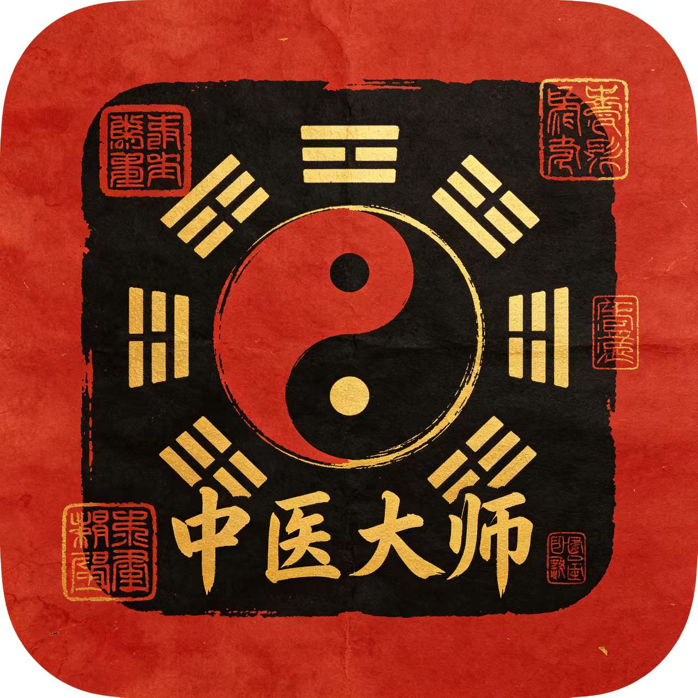
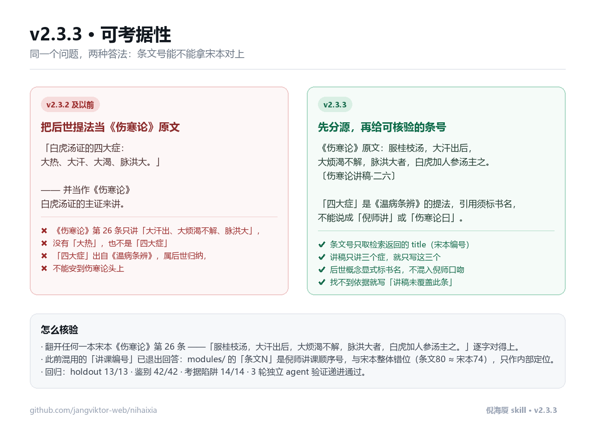
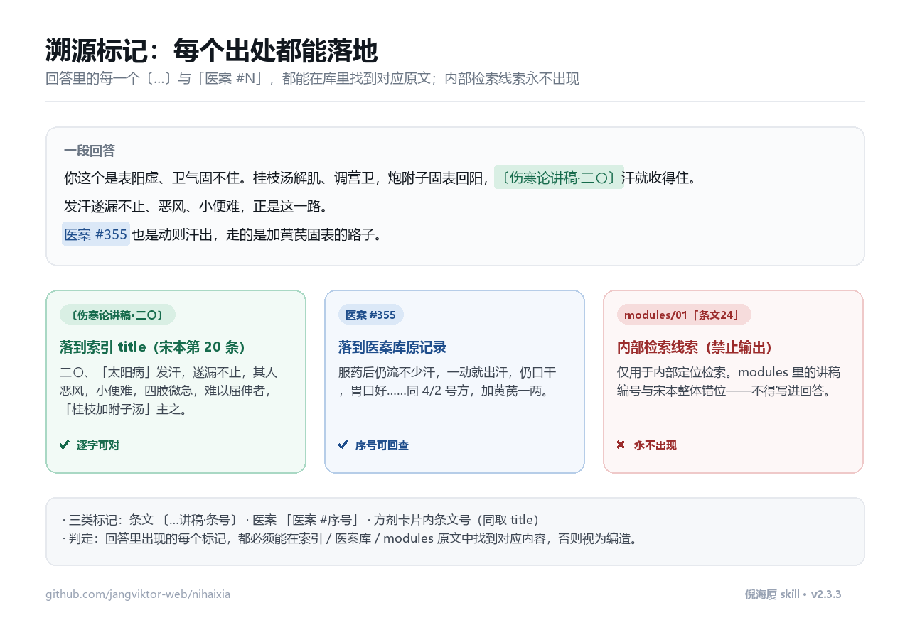
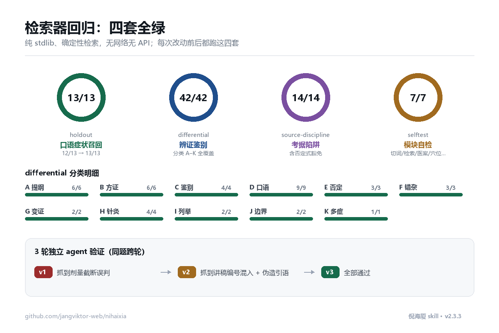

<div align="center">



# 倪海廈 스킬 · 경방 중의학 AI

**경방의 대가 倪海廈의 중의학 사고 체계를 AI 에이전트에 주입하다**

`상한론 129조 + 태양 하편·양명편 보완` · `금궤요략 23편` · `황제내경 72편` · `본초 374종` · `구조화 의안 1,257례 + 서사 의안 243례` · `강의 2,452쪽` · `정수 350만 자`

[](https://github.com/jangviktor-web/nihaixia/stargazers)
[](https://github.com/jangviktor-web/nihaixia/releases)
[](LICENSE)
[]()
[](#빠른-설치)

**🌐 [中文](https://github.com/jangviktor-web/nihaixia/blob/main/README.md) | [English](https://github.com/jangviktor-web/nihaixia/blob/main/README_EN.MD) | [日本語](https://github.com/jangviktor-web/nihaixia/blob/main/README_JA.md) | [한국어](https://github.com/jangviktor-web/nihaixia/blob/main/README_KO.md)**

</div>

---

> "중의학은 간단하다. 음양과 기혈, 그뿐이다. 그것을 깨치면 모든 것이 통한다." — 倪海廈

### 한 줄 소개

倪海廈(1954-2012)의 중의학 사고, 人紀 시리즈 강의, 임상 심법, 天紀 명리를 활성화 가능한 Agent Skill로 증류했습니다. AI가 倪海廈의 관점에서 육경변증·경방 선택·증상 해석을 수행할 수 있게 합니다.

**활성화 키워드**: `倪海廈` / `海廈 관점` / `倪師` / `경방 사고` / `倪海廈라면 어떻게 볼까`

---

## 빠른 설치

<details open>
<summary><b>ClawHub (권장)</b></summary>

```bash
openclaw skills install @jangviktor-web/nihaixia
```
</details>

<details>
<summary><b>SkillHub (Tencent Cloud)</b></summary>

```bash
curl -fsSL https://skillhub.cn/install/install.sh | bash -s -- --no-skills
skillhub install nihaixia-pro
```
</details>

<details>
<summary><b>수동 설치 (원하는 런타임의 skills 디렉터리로 복사)</b></summary>

```bash
git clone https://github.com/jangviktor-web/nihaixia.git

# 예: OpenClaw → ~/.openclaw/skills/
#     Claude Code → ~/.claude/skills/
#     Codex → ~/.codex/skills/
cp -r nihaixia ~/.openclaw/skills/
```
</details>

---

## 기능 매트릭스

| 능력 | 지원 | 내용 |
|:---|:---:|:---|
| 육경변증 | ✅ | 태양／양명／소양／태음／소음／궐음, 전변 규칙 + 욕해시 |
| **육경변증 진단 공식** | ✅ | **8개 진단 공식 + 신속 진단 순서도 + 맥·설 빠른 조회 + 칠보 사고 모델 (v2.1.0 추가)** |
| 경방 선택 | ✅ | 상한론 129조 + 태양 하편·양명편 보완 + 금궤 23편, 조성／용량／전탕법／금기 포함 |
| 본초 성미 | ✅ | 신농본초경 374종, 삼품 분류 + 오미 귀경 + 포제 요점 |
| 임상 의안 | ✅ | 구조화 의안 1,257례 + 분류 서사 의안 243례, 암／심혈관／대사병 등 7분류 |
| 침구 경혈 | ✅ | 십이경락 + 정형수경합 + 임독 요혈 + 중풍 응급 |
| 황제내경 | ✅ | 72편 완전 증류, 중의학 기초 이론의 핵심 |
| 천기 명리 | ✅ | 자미두수 + 주역 육십사괘 + 양택 풍수 |
| 양동 대담 | ✅ | 2009년 전 7회 녹음 증류, 현대적 주제에 대한 견해 |
| 제3회 부양 포럼 강연 | ✅ | 부양 이론／음허→양허→음실 전변 사슬／홍반성낭창·백혈병·뇌종양 임상 중증례／생부자·생유황 분류 응용 |
| 중경심법 강의 | ✅ | 경방 용량학／계지탕은 군방의 조상／방풍감부탕→지모탕→오두탕 단계 심화／소화기계 경방 대응／젖이 곧 월경·칠암 동원／손등·이마 온도차로 음양을 즉단하는 수진법 |
| 스탠퍼드 대학 강연 + 제자 경험 | ✅ | 감기에서 암까지／경방 입문 삼보／이종은·양정 제자 실록／망진 총결 + 진병 십문／상용 압통점／담석·신석 전용방 |
| 폐문 강의 | ✅ | 7대 중병 주제 + 7당 제자 강의, 백혈병／유방암／뇌종양 등 |
| 구술 표현 | ✅ | 倪海廈 구어체 스타일 모듈, 답변이 "倪師처럼" 들리게 |
| **검증 가능성** | ✅ | **조문 번호를 송본 번호로 통일(송본이 있으면 누구나 한 조씩 대조 가능) + 출처 규율(후대 개념을 『상한론』에 귀속시키지 않음) + 출처 감사(근거 없는 방명 자동 추출) + 고증 함정 판정 14/14 (v2.3.3 신규)** |
| **재현 가능한 검색기** | ✅ | `scripts/nishi_retrieve.py`는 순수 stdlib으로 결정적으로 동작. `--selftest`와 세 가지 회귀(holdout 13/13, 감별 42/42, 고증 14/14) |

---

## 사용 예시

**감기 변증**
> **Q**: 감기에 걸렸습니다. 추위를 타고, 땀이 없으며, 목 뒤가 아픕니다.
> **A**: 태양상한, 마황탕증. 무한·오한·신체통 — 한이 표를 묶고 있다. 마황은 모공을 열고, 계지는 근육을 풀며, 행인은 기를 내린다.

**방제 조회**
> **Q**: 소시호탕은 언제 씁니까?
> **A**: 소양병의 주방. 구고·인간·목현·왕래한열 — 한 증만 보여도 쓸 수 있다.

**본초 성미**
> **Q**: 생부자와 포부자의 차이는?
> **A**: 생부자 — 음한이 안에 있는 사역증. 포부자 — 표양이固하지 못한 한출오풍.

**의안 참고**
> **Q**: 간암 의안이 있습니까?
> **A**: 있습니다. 암 의안이 147례. 간암에는 공격 처방에 소간이기(疏肝理氣)를 배합하는 것이 상도입니다.

---

## 데모

<div align="center">

**같은 질문, 두 가지 답: 조문 번호를 송본으로 대조할 수 있는가**


**출처 표식: 모든 인용에 근거가 있다**


**검색기 회귀: 네 계열 모두 통과**


</div>

---

## 핵심 지식 체계

### 육경변증 빠른 조회

| 육경 | 개합추 | 주요 병증 | 대표방 |
|:---|:---:|:---|:---|
| 태양 | 개 | 표증, 두항강통, 오한 | 계지탕·마황탕·갈근탕 |
| 양명 | 합 | 리실열, 위가실, 대변경 | 백호탕·승기탕류 |
| 소양 | 추 | 왕래한열, 흉협고만, 구고 | 소시호탕 |
| 태음 | 개 | 복만이토, 자리익심 | 이중탕·소건중탕 |
| 소음 | 추 | 맥미세, 단욕매 | 사역탕·진무탕 |
| 궐음 | 합 | 소갈, 기상당심, 수족궐랭 | 오매환·당귀사역탕 |

### 倪氏 여섯 가지 건강 기준

1. 밤에 푹 잔다 (23시~새벽 5시)
2. 식욕이 정상이고 식후에 더부룩하지 않다
3. 매일 아침 배변이 있다
4. 하루 5~7회, 소변이 맑고 양이 많다
5. 손발이 따뜻하다 (머리는 서늘하고 발은 따뜻하다)
6. 아침에 일어나면 정력이 있다

---

## 데이터 출처

- 「人紀」 시리즈 강의: 상한론·금궤요략·황제내경·신농본초경·침구대성
- 「天紀」 시리즈: 자미두수·주역·양택 풍수
- 양동 대담 (2009년, 전 7회)
- 임상 의안 1,257례(구조화) + 243례(분류 서사)
- 제3회 부양 포럼, 스탠퍼드 대학 강연, 폐문 강의

> 모든 내용은 중의학 학습·학술 연구를 목적으로 하며, 倪海廈 본인의 견해를 요약·증류한 것입니다. 원문의 축자적 재현이 아닙니다.

---

## 업데이트 내역

#### v2.3.3 (2026-11-27) — 출처 규율과 검증 가능성: 조문 번호를 대조 가능하게

- **출처 규율**: 조문 번호는 검색이 반환한 `title`(송본 번호)에서만. 강의가 「대한출·대번갈·맥홍대」 세 가지만 말했다면 세 개만 쓰고, 『온병조변』의 「사대증」으로 『상한론』을 뒷받침하지 않는다
- **출처 표식**: `〔상한론강고·구육〕`, `〔금궤요략강고·구이발열〕`, `의안 #번호`를 본문에 표기해 한 조씩 대조 가능
- **번호 통일**: 색인 `title` 접두사 = 송본 번호를 대외 표기에 사용. `modules/`의 「조문N」은 강의 순번(송본과 어긋남)이며 내부 위치 지정 전용
- **검색기**: 부정어(불갈／무한／불오한)와 방위어(왼쪽／배／아침)를 priority 층에 넣어 자유율 필터를 면제 — holdout 12/13 → **13/13**
- **출처 감사**: `unverified_formulas()`가 근거 없는 방명을 추출(지적만, 차단하지 않음)
- **고증 함정 판정**: `test_source_discipline.py`가 문장 단위로 「후대 개념을 『상한론』에 귀속시켰는지」 판정, 부정 표현·반문 면제 포함, 14/14 통과
- **용량 대조**: 검색 단편은 520자에서 잘리므로, 방제 용량은 반드시 `modules/`에서 원방 행을 한 글자씩 대조

지난 이력은 [CHANGELOG.md](CHANGELOG.md)를 참고하세요.

---

## 관련 프로젝트

- [漢唐中醫 · Android 진단 앱](https://github.com/jangviktor-web/nihaixia-app) — 동일한 지식 체계를 탑재한 Android 앱
- [리커 스킬 · 중증 응급 중의학 AI](https://github.com/jangviktor-web/likeskill)
- [호희서 스킬 · 경방 중의학 AI](https://github.com/jangviktor-web/huxishu)
- [온병파 오국통 스킬 · 온병파 중의학 AI](https://github.com/jangviktor-web/wujutong)

---

## 감사의 글

倪海廈 선생의 강의와 임상 기록을 남겨 주신 가족·제자 여러분, 그리고 공개 자료를 정리해 주신 커뮤니티에 감사드립니다.

## Star History

[](https://star-history.com/#jangviktor-web/nihaixia&Date)

## 면책 조항

> ⚠️ 본 내용은 중의학 학습 및 학술 연구만을 목적으로 하며, 의료 진단·처방·개별화된 치료 제안을 구성하지 않습니다. 몸에 이상이 있으면 집업 중의사와 상담하십시오. 급성·중증의 경우 즉시 의료기관을 방문하십시오.
